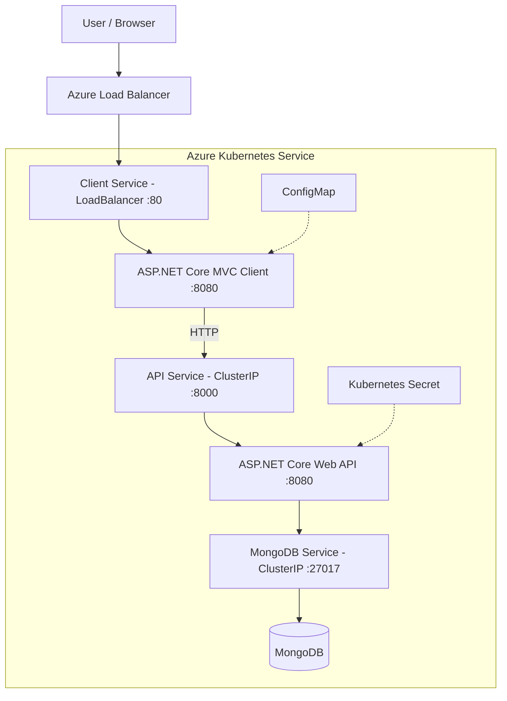
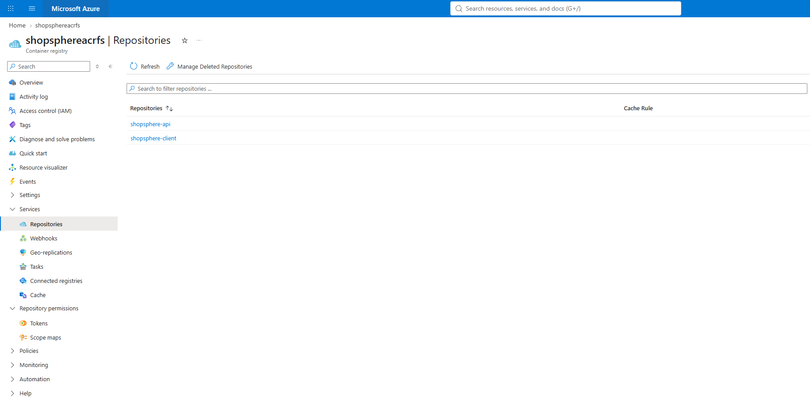
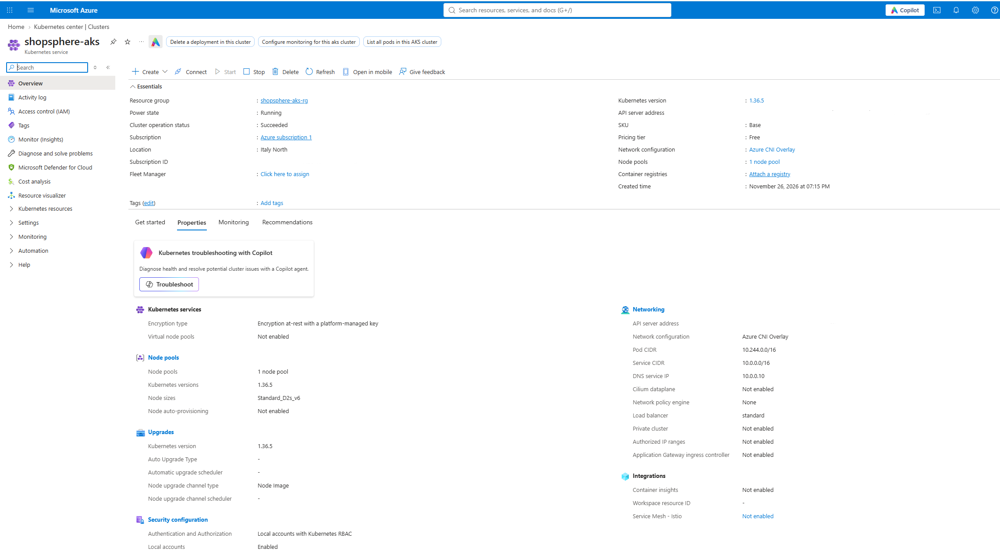
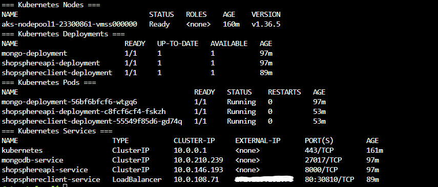
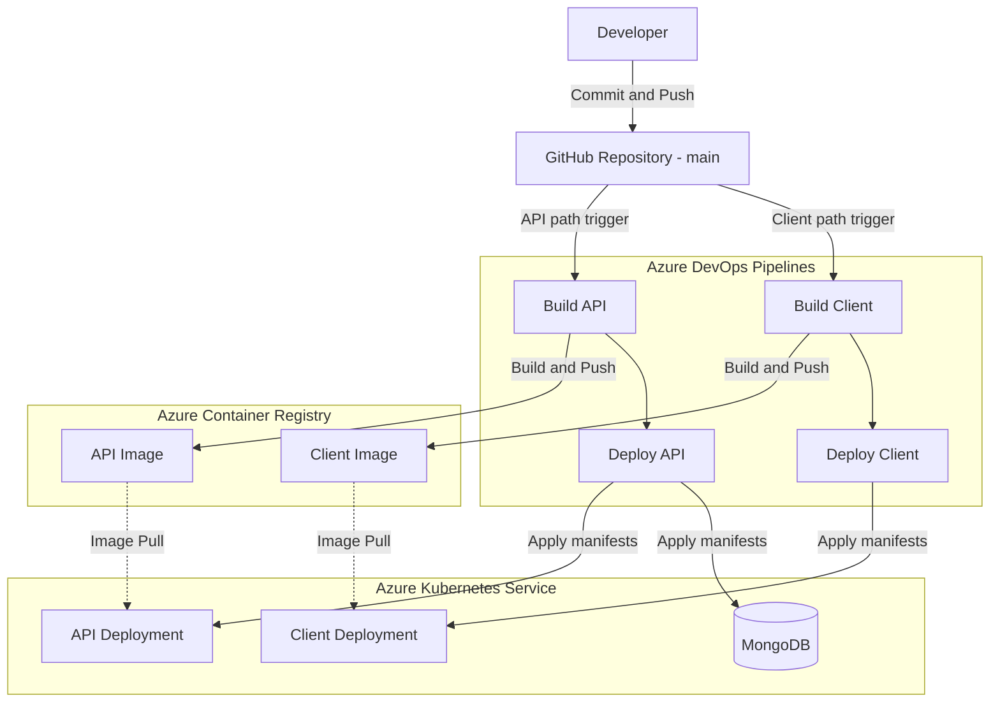
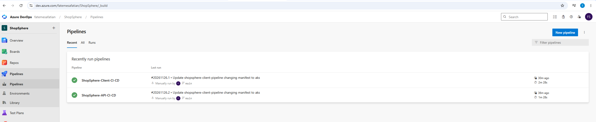
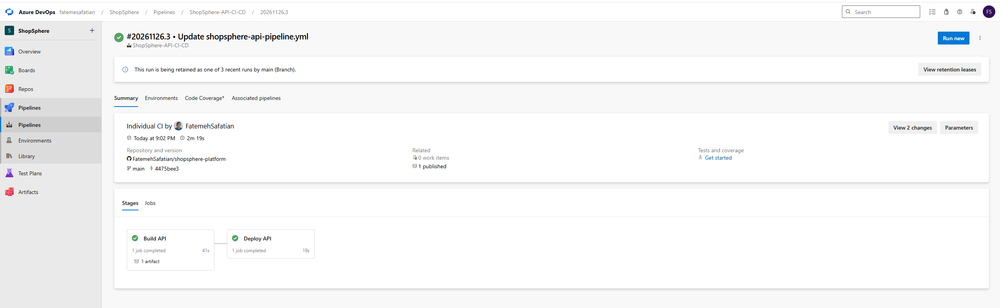
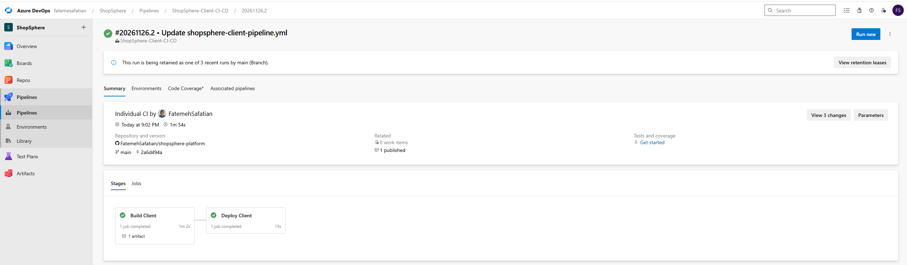
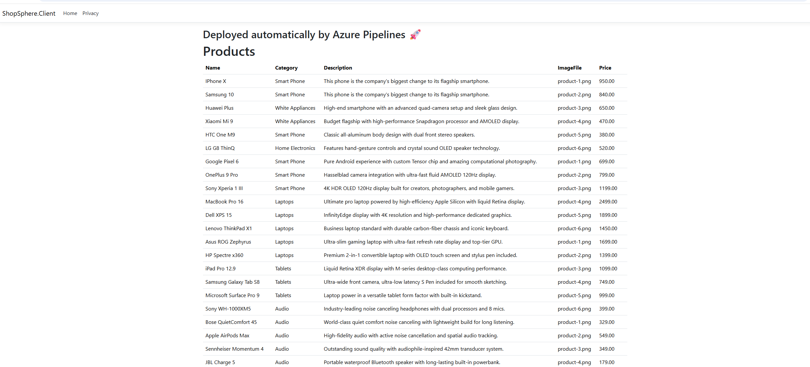

# ShopSphere Platform

### Cloud-Native Application | Docker | Kubernetes | Azure DevOps

**Backend CI/CD**

[](https://dev.azure.com/fatemesafatian/ShopSphere/_build/latest?definitionId=3&branchName=main)

**Frontend CI/CD**

[](https://dev.azure.com/fatemesafatian/ShopSphere/_build/latest?definitionId=4&branchName=main)

## 1. Project Overview

ShopSphere is a hands-on cloud-native application developed to demonstrate service-based architecture, containerization, Kubernetes orchestration, Microsoft Azure infrastructure, and automated CI/CD pipelines.

The application consists of an ASP.NET Core MVC web client, an independently deployable ASP.NET Core Web API, and a MongoDB database.

The frontend intentionally provides a minimal product catalog interface. The primary focus of this project is backend development, distributed application architecture, infrastructure configuration, and deployment automation rather than UI/UX design.

### Project Objectives

- Develop independently deployable application components.
- Containerize applications using Docker.
- Manage multi-container applications using Docker Compose.
- Orchestrate containerized workloads using Kubernetes.
- Provision cloud infrastructure using Azure CLI.
- Manage container images through Azure Container Registry.
- Deploy applications to Azure Kubernetes Service.
- Implement independent YAML-based CI/CD pipelines.
- Configure service discovery, application settings, and registry authentication.
- Troubleshoot cloud infrastructure and deployment issues.

## 2. Technology Stack

| Category | Technology |
|---|---|
| Programming Language | C# |
| Framework | .NET 10 |
| Frontend | ASP.NET Core MVC |
| Backend | ASP.NET Core Web API |
| Database | MongoDB |
| Database Driver | MongoDB .NET Driver |
| API Documentation | Swagger / OpenAPI |
| Containerization | Docker |
| Multi-container Management | Docker Compose |
| Container Orchestration | Kubernetes |
| Cloud Platform | Microsoft Azure |
| Container Registry | Azure Container Registry (ACR) |
| Managed Kubernetes | Azure Kubernetes Service (AKS) |
| CI/CD | Azure DevOps Pipelines, GitHub Actions |
| Infrastructure Management | Azure CLI |
| Kubernetes Management | kubectl |
| Configuration | YAML, ConfigMaps, Kubernetes Secrets |
| Development Environment | GitHub Codespaces (Dev Container), kind |
| Version Control | Git and GitHub |

## 3. Application Architecture

The application is divided into three independently deployed components.

| Component | Responsibility |
|---|---|
| ShopSphere.Client | Presents the product catalog and communicates with the backend API through HTTP |
| ShopSphere.API | Provides product-related API functionality and database access |
| MongoDB | Stores application data |

The web client communicates with the backend through a configured HTTP client. Kubernetes service discovery enables communication between application components without exposing the backend API or database directly to the internet.



### Application Communication

- The client is publicly accessible through a Kubernetes LoadBalancer service.
- The backend API is accessible internally through a ClusterIP service.
- MongoDB is accessible internally through a dedicated ClusterIP service.
- The client receives the backend API address through a Kubernetes ConfigMap.
- The backend receives the database connection string through a Kubernetes Secret.

## 4. Repository Structure

```text
shopsphere-platform/
├── .devcontainer/
├── .github/
│   └── workflows/
│       └── docker-publish.yml
├── ShopSphere/
│   ├── ShopSphere.API/
│   │   └── Dockerfile
│   ├── ShopSphere.Client/
│   │   └── Dockerfile
│   └── docker-compose.yml
├── aks/
│   ├── command.txt
│   ├── mongo.yml
│   ├── mongo-secret.yaml
│   ├── shopsphere-api.yml
│   ├── shopsphere-client.yml
│   └── shopsphere-client-configmap.yml
├── k8s/
├── pipelines/
│   ├── shopsphere-api-pipeline.yml
│   └── shopsphere-client-pipeline.yml
├── docs/
│   └── screenshots/
└── README.md
```

| Directory | Description |
|---|---|
| .devcontainer/ | GitHub Codespaces environment with kubectl and a local kind cluster |
| .github/workflows/ | GitHub Actions workflow that publishes the images to Docker Hub |
| ShopSphere/ | Application source code and Docker configuration |
| k8s/ | Kubernetes manifests for a local cluster (Docker Desktop / kind), using images from Docker Hub |
| aks/ | AKS manifests using images from ACR, plus the Azure CLI command reference ([command.txt](aks/command.txt)) |
| pipelines/ | Azure DevOps YAML pipeline definitions |
| docs/screenshots/ | Deployment documentation and verification screenshots |

## 5. Docker Containerization

The backend API and web client are containerized independently using dedicated Dockerfiles.

Docker Compose defines three application services:

- `shopsphere.api`
- `shopsphere.client`
- `shopping.db` (MongoDB)

This configuration provides the foundation for running the application as a multi-container system before deploying it to Kubernetes.

### Container Configuration

- Separate Docker images for the API and client.
- Linux-based application containers listening on port 8080.
- MongoDB database container.
- Independent application build configurations.

### Running Locally

```bash
# Docker Compose
cd ShopSphere
docker compose up --build

# Local Kubernetes (Docker Desktop or kind)
kubectl apply -f k8s/
```

### GitHub Actions

On every push to `main`, a GitHub Actions workflow builds both images and publishes them to Docker Hub (tags `latest` and the commit SHA). These images are used by the local Kubernetes manifests in `k8s/`.

### Source Files

- [Backend Dockerfile](ShopSphere/ShopSphere.API/Dockerfile)
- [Client Dockerfile](ShopSphere/ShopSphere.Client/Dockerfile)
- [Docker Compose configuration](ShopSphere/docker-compose.yml)
- [GitHub Actions workflow](.github/workflows/docker-publish.yml)

## 6. Azure Cloud Infrastructure

The application was successfully deployed to Microsoft Azure using Azure Container Registry and Azure Kubernetes Service.

| Resource | Configuration |
|---|---|
| Container Registry | shopsphereacrfs |
| ACR Pricing Tier | Basic |
| ACR Resource Group | shopsphere-acr-rg |
| Kubernetes Cluster | shopsphere-aks |
| AKS Resource Group | shopsphere-aks-rg |
| Azure Region | Italy North |
| Kubernetes Version | 1.36.5 |
| AKS Pricing Tier | Free |
| Worker Node Size | Standard_D2s_v6 |
| Worker Nodes | 1 |
| Node Pools | 1 |
| Networking | Azure CNI Overlay |

The infrastructure was provisioned for development and learning purposes using Azure CLI.

The registry and the cluster are placed in **separate resource groups**. The cluster can be deleted after each working session to save costs, while the registry, and the Azure DevOps service connection that depends on it, stay intact.

### Azure Container Registry (ACR)

The API and client Docker images are stored in separate Azure Container Registry repositories.

| Image Repository | Component |
|---|---|
| shopsphere-api | Backend Web API |
| shopsphere-client | ASP.NET Core MVC Client |

Images are automatically built and pushed to ACR by Azure DevOps Pipelines. Each pipeline uses its build identifier as the Docker image tag.



### Azure Kubernetes Service (AKS)

Azure Kubernetes Service provides the managed Kubernetes environment for deploying and running the containerized application.

The following screenshot documents the AKS cluster configuration used during the deployment demonstration.



## 7. Kubernetes Deployment

The application is deployed using declarative Kubernetes YAML manifests.

### Kubernetes Resources

| Resource | Purpose |
|---|---|
| Deployment | Manages application replicas and updates |
| Pod | Runs application containers |
| ClusterIP Service | Enables internal service communication |
| LoadBalancer Service | Exposes the web client publicly |
| ConfigMap | Provides application configuration |
| Secret | Supplies database connection configuration |
| Image Pull Secret | Authenticates image pulls from ACR |

### Kubernetes Services

| Service | Type | Service Port | Target Port |
|---|---|---|---|
| shopsphereclient-service | LoadBalancer | 80 | 8080 |
| shopsphereapi-service | ClusterIP | 8000 | 8080 |
| mongodb-service | ClusterIP | 27017 | 27017 |

The client accesses the backend API using the internal Kubernetes service address:

```text
http://shopsphereapi-service:8000/
```

The API and database remain internal to the cluster.

### Deployment Configuration

- Independent deployments for the API, client, and MongoDB.
- One replica per application deployment during the demonstration.
- CPU and memory requests and limits for the application containers.
- Rolling update strategy for the client (`maxSurge: 1`, `maxUnavailable: 0`) for zero-downtime releases.
- ConfigMap-based backend endpoint configuration.
- Secret-based database connection configuration.
- Private registry authentication using an image pull secret created by the pipeline.

### Deployment Verification

The following commands were used to verify the Kubernetes environment:

```bash
kubectl get nodes
kubectl get deployments -n default
kubectl get pods -n default
kubectl get services -n default
```

At the time of verification:

| Metric | Result |
|---|---|
| Ready Worker Nodes | 1/1 |
| Available Deployments | 3/3 |
| Running Application Pods | 3/3 |
| Container Restarts | 0 |



## 8. Azure DevOps CI/CD Pipelines

The project implements two independent YAML-based CI/CD pipelines integrated with GitHub.

- ShopSphere-API-CI-CD
- ShopSphere-Client-CI-CD

Each pipeline is configured with branch and path-based triggers, so a change to the API only runs the API pipeline, and a change to the client only runs the client pipeline.

### CI/CD Architecture



### Pipeline Overview



### Path-Based Triggers

| Pipeline | Runs when these paths change |
|---|---|
| ShopSphere-API-CI-CD | `ShopSphere/ShopSphere.API`, `aks/shopsphere-api.yml`, `aks/mongo.yml`, `aks/mongo-secret.yaml`, its own pipeline file |
| ShopSphere-Client-CI-CD | `ShopSphere/ShopSphere.Client`, `aks/shopsphere-client.yml`, `aks/shopsphere-client-configmap.yml`, its own pipeline file |

### Backend API Pipeline

**Continuous Integration**

- Retrieve source code from GitHub.
- Build the backend Docker image.
- Tag the image using the pipeline build identifier.
- Push the image to Azure Container Registry.
- Publish Kubernetes manifests as a pipeline artifact.

**Continuous Deployment**

- Connect to the AKS Kubernetes environment.
- Configure the registry image pull secret.
- Deploy MongoDB and its configuration.
- Deploy or update the backend API with the newly built image tag.

[View API Pipeline YAML](pipelines/shopsphere-api-pipeline.yml)



### Frontend Client Pipeline

**Continuous Integration**

- Retrieve source code from GitHub.
- Build the web client Docker image.
- Tag and push the image to ACR.
- Publish Kubernetes manifests.

**Continuous Deployment**

- Connect to the AKS environment.
- Configure registry authentication.
- Apply the client ConfigMap.
- Deploy or update the web client using the newly built image.

[View Client Pipeline YAML](pipelines/shopsphere-client-pipeline.yml)



### Pipeline Implementation

| Configuration | Implementation |
|---|---|
| Source Control | GitHub |
| Trigger Branch | main |
| Trigger Filtering | Path-based triggers |
| Build Agent | Microsoft-hosted Ubuntu agent |
| Container Build Task | Docker@2 |
| Deployment Task | KubernetesManifest@1 |
| Image Tagging | Build.BuildId |
| Image Tag Substitution | `containers` input of the deployment task replaces the tag in the manifests |
| Artifact | Kubernetes deployment manifests |
| Registry Authentication | Docker Registry Service Connection |
| Deployment Target | AKS Kubernetes Environment |

## 9. Application Demonstration

The application was successfully deployed to AKS and accessed through the public endpoint provided by the Kubernetes LoadBalancer service.

The heading on the page was changed in a single commit, which automatically triggered the client pipeline and rolled out the new version to AKS.



The application interface is intentionally minimal because the project focuses on cloud infrastructure, container orchestration, and deployment automation.

## 10. Infrastructure Provisioning

The following commands document the Azure CLI configuration used for the demonstration infrastructure. The full step-by-step reference is in [aks/command.txt](aks/command.txt).

**Prerequisites**

- Azure subscription
- Azure CLI
- kubectl
- Azure DevOps organization and project
- GitHub repository
- Appropriate Azure resource and deployment permissions

### Create Azure Container Registry

```bash
az group create \
  --name shopsphere-acr-rg \
  --location italynorth

az acr create \
  --resource-group shopsphere-acr-rg \
  --name shopsphereacrfs \
  --sku Basic
```

### Create Azure Kubernetes Service

```bash
az group create \
  --name shopsphere-aks-rg \
  --location italynorth

az aks create \
  --resource-group shopsphere-aks-rg \
  --name shopsphere-aks \
  --location italynorth \
  --node-count 1 \
  --node-vm-size Standard_D2s_v6 \
  --node-osdisk-size 30 \
  --tier free \
  --generate-ssh-keys
```

### Connect to the Cluster

```bash
az aks get-credentials \
  --resource-group shopsphere-aks-rg \
  --name shopsphere-aks \
  --overwrite-existing

kubectl get nodes
```

### Configure Azure DevOps

1. Connect the GitHub repository to Azure DevOps.
2. Configure a Docker Registry Service Connection for ACR.
3. Create a Kubernetes Environment connected to AKS.
4. Configure the API and client pipelines using the existing YAML files.
5. Update registry names, service connection identifiers, environment names, and deployment configuration as needed.
6. Run the API pipeline followed by the client pipeline.
7. Verify Kubernetes deployments, pods, and services.
8. Retrieve the frontend LoadBalancer external IP address.

Azure resource names, VM availability, permissions, and Kubernetes requirements may vary between subscriptions. The configuration above documents the demonstration rather than a universal deployment template.

## 11. Troubleshooting and Technical Challenges

### Selecting a VM Size Under Subscription Quotas

**Problem:** The default burstable VM sizes could not be used for the AKS node.

**Root Cause:** `Standard_B2s` is not offered in Italy North, and the newer `Standard_B2s_v2` and `Standard_D2s_v5` families had a quota of zero in the subscription.

**Resolution:** Regional availability (`az vm list-skus`) was compared with the subscription's family quotas (`az vm list-usage`). `Standard_D2s_v6` was the only 2-vCPU size that satisfied both conditions.

### Zero-Downtime Rolling Update with Insufficient CPU

**Problem:** During a rolling update, the new client pod stayed in `Pending` (`0/1 nodes are available: Insufficient cpu`).

**Root Cause:** The single node could not reserve the requested CPU for an additional pod, because Kubernetes schedules pods based on `resources.requests`, not actual usage.

**Resolution:** `resources.requests.cpu` was lowered from `250m` to `100m`. Because the rolling update used `maxUnavailable: 0`, the old pod kept serving traffic the whole time, so the site had no downtime.

### Corporate Firewall Blocking a Non-Standard Port

**Problem:** The application was not reachable from the corporate network.

**Root Cause:** A `curl` request from Azure Cloud Shell returned `200 OK`, which proved the application was healthy. The corporate firewall blocked the non-standard port 8001.

**Resolution:** The client Service was exposed on the standard HTTP port 80.

### Docker Build Context in the Pipeline

**Problem:** The Docker build in the pipeline could not find the files referenced by the `COPY` instructions.

**Root Cause:** The `Docker@2` task uses the Dockerfile's folder as the build context by default, while the Dockerfiles expect the `ShopSphere/` folder.

**Resolution:** The `buildContext` input was set to `$(Build.SourcesDirectory)/ShopSphere`.

### AKS Connectivity After Cluster Recreation

**Problem:** The deployment stage failed with a DNS resolution error after the AKS cluster was recreated.

**Root Cause:** The Azure DevOps Kubernetes Environment retained connection information associated with the previous Kubernetes API server. Although the new cluster had the same name, its API server address was different.

**Resolution:**

- Verified the current AKS cluster using Azure CLI.
- Compared its API server address with the address reported in the pipeline error.
- Recreated the Kubernetes resource connection within the existing Azure DevOps Environment.
- Executed the pipeline again without changing the environment name in the YAML configuration.

**Result:** Both build and deployment stages completed successfully.

### Kubernetes Deployment Task Upgrade

The original pipelines used the deprecated `KubernetesManifest@0` task. Both pipeline definitions were updated to `KubernetesManifest@1`, followed by successful automated CI/CD executions.

## 12. Security and Project Limitations

This project is a development and learning demonstration rather than a production-ready e-commerce system.

- No real credentials, access tokens, or registry passwords are stored in the repository.
- The ACR image pull secret is created at deploy time by the pipeline from the Azure DevOps service connection.
- `aks/mongo-secret.yaml` contains **demo-only** credentials for this learning environment. In production, secrets would be created at deploy time or managed with Azure Key Vault.

Production improvements would include:

- Managing sensitive credentials through a secure external secret management solution such as Azure Key Vault.
- Authorizing AKS to pull from ACR with a managed identity (`AcrPull` role) instead of an image pull secret.
- Configuring an Ingress controller with HTTPS and TLS certificates.
- Introducing automated unit and integration testing in the pipelines.
- Adding application health probes.
- Configuring centralized logging and monitoring.
- Adding persistent storage and a backup strategy for MongoDB.
- Introducing infrastructure as code using Terraform or Bicep.
- Configuring separate development and production environments with approval gates.
- Improving identity management and least-privilege access.

## 13. Cloud Cost Management

Azure infrastructure was provisioned temporarily for learning, testing, and deployment verification.

- The AKS cluster lives in its own resource group and is deleted after each working session.
- The container registry (Basic tier) lives in a separate resource group, so it can be kept between sessions without breaking the pipelines, and removed when the project is finished.
- Azure Pipelines runs within the free tier of Microsoft-hosted agents.

The Azure DevOps project, pipeline definitions, source code, and deployment screenshots are retained for documentation and future use.

The application is therefore not permanently hosted online. Pipeline badges represent pipeline execution status, not live application availability.

## 14. Key Learning Outcomes

This project demonstrates practical experience with:

- ASP.NET Core application development
- HTTP-based service communication
- Docker and Docker Compose
- Kubernetes deployments, services, ConfigMaps, and Secrets
- Rolling updates and resource requests/limits
- Azure cloud infrastructure provisioning
- Azure Container Registry
- Azure Kubernetes Service
- Azure DevOps service connections and environments
- Independent YAML-based CI/CD pipelines
- Automated branch and path-based triggers
- Container image versioning
- Cloud deployment troubleshooting
- Deployment verification and cost management

---

**Project focus:** Cloud-Native Development · Backend Engineering · Docker · Kubernetes · Microsoft Azure · DevOps · CI/CD
